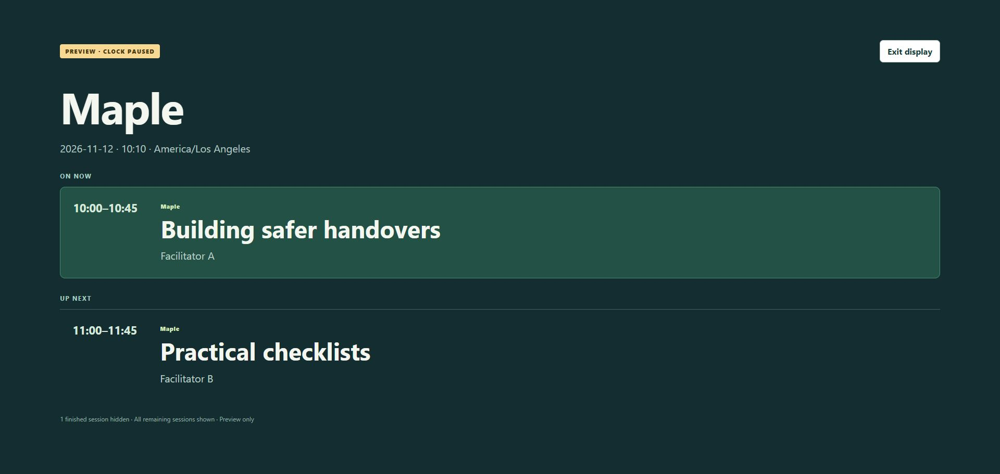

# Room Board

Turn a conference schedule CSV into a room screen that shows the current session and what comes next. Finished sessions disappear automatically when the live venue clock is running.

**[Open Room Board](https://srworkbench.github.io/room-board/)**. Free, no account or installation.



## Try it in a minute

1. Open the page and click **Load example**.
2. Choose **Maple** under Room. The example previews November 12, 2026 at 10:10: one session is on now, one is next, and the earlier one is hidden.
3. Click **Open room display**. Use **Exit display** or Escape to return to setup.

The example is fictional. The amber **Preview** label means the clock is paused. To use an actual event schedule, load your CSV, check the venue time zone, then click **Use live venue clock** before opening the display.

## Use your schedule

Export your spreadsheet as UTF-8 CSV with this header:

```csv
date,start,end,room,title,speaker
2026-11-12,10:00,10:45,Maple,Building safer handovers,Facilitator A
2026-11-12,11:00,11:45,Maple,Practical checklists,Facilitator B
```

`speaker` is optional. The other five columns are required. Additional columns are ignored. Dates use `YYYY-MM-DD`; times use 24-hour `HH:MM`. Each session must end later on the same date; an end of `24:00` means midnight at the end of that date. Split overnight sessions into separate records: for example, `23:30–24:00` on one date and `00:00–00:30` on the next. Room names ignore case and repeated spaces when checking overlaps.

Choose a CSV file to build automatically, or paste CSV and click **Build board**. Parallel sessions in different rooms are allowed. Missing values, invalid dates/times and same-room overlaps hold the display until corrected. Edit the CSV text or fix your spreadsheet and import again. Record numbers count the header and blank records; a quoted field containing line breaks is still one record.

Choose one room or **All rooms**. The board shows every current session and the next four sessions for that date. Earlier sessions are hidden. Preview a date/time to check a future event. The live clock follows the selected venue time zone and updates every 15 seconds while the tab is running. Check the computer clock before use.

**Download sorted CSV** saves the displayed schedule in time order. It includes only the six supported columns. Text that could be interpreted as a spreadsheet formula gets a leading apostrophe for safety; exported formula-like text therefore differs from the original input.

## Limits and privacy

- Up to 1,000 CSV records and 500,000 characters. File selection also rejects files over 2 MB. Text fields have length limits shown in validation messages.
- Your schedule is processed in this tab. There are no analytics, third-party scripts, upload requests or stored schedules. Closing or reloading the page clears it. The web host receives ordinary page requests; the CSV is not included in them.
- Once the page is loaded, displaying an imported schedule needs no further network requests. Reloading still needs access to the site. Keep the tab open and prevent the display device from sleeping.
- Each screen needs its own import and room selection. Changes do not sync. There are no calendar feeds, sponsor rotations, proof-of-play reports, bookings or remote screen management.
- During a daylight-saving clock repeat, sessions follow the repeated venue wall-clock time. The tool does not distinguish the first occurrence from the second. Avoid scheduling in an ambiguous clock-change hour.

## Development

The page uses plain HTML, CSS and JavaScript with no build step or external libraries. Node is needed only for development checks:

```sh
node --test tests/core.test.cjs
node demo.cjs
```

The demo writes made-up results under the ignored `output/` folder.

MIT licensed. An independent tool by SR Workbench.
